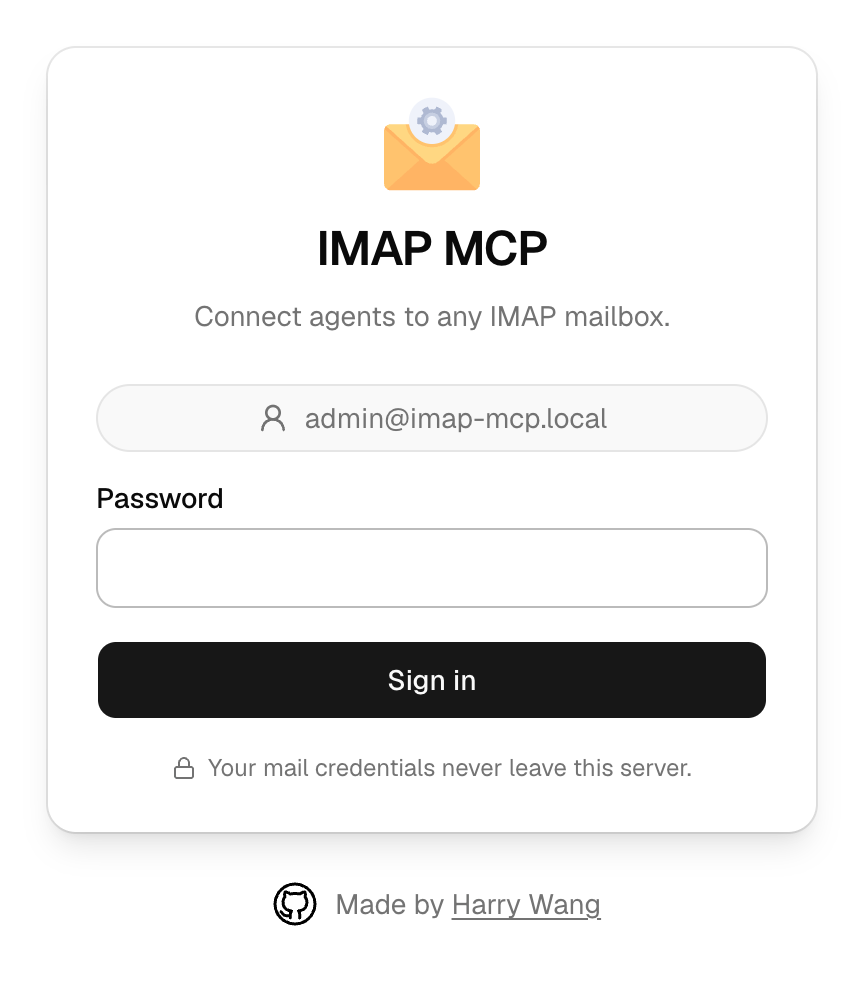

# IMAP MCP

A personal MCP server that gives AI agents (Claude, ChatGPT, Cursor, VS Code, or any MCP client) access to any IMAP mailbox.

<p align="center"></p>

- **Next.js 16 + Better Auth + shadcn/ui**, deployed on Vercel with a Neon Postgres database. One Vercel account covers everything.
- **OAuth login, nothing secret in the URL.** Your agent registers itself (dynamic client registration). You sign in once and approve it on a consent page. Access tokens last 1 hour, refresh tokens 30 days.
- **Multiple mailboxes, kept apart.** Add up to 20 (`MAIL_2`, `MAIL_3`, …). Every result says which mailbox it came from, replies go out from the mailbox the original arrived in, and when it's unclear which one you mean, the agent is told to ask instead of guessing.
- **Drafts by default.** The agent saves replies to your Drafts folder and you send them yourself. Set `ALLOW_SEND=true` to let it send.
- **Mail passwords never touch the database.** They live only in Vercel environment variables. The database holds login and OAuth data.

## Deploy

[](https://vercel.com/new/clone?repository-url=https%3A%2F%2Fgithub.com%2Fharrywang%2Fimap-mcp&project-name=imap-mcp&repository-name=imap-mcp&env=MAIL_1,MAIL_1_PASSWORD,ADMIN_PASSWORD,BETTER_AUTH_SECRET&envDescription=Your%20mailbox%20address%20and%20password%2C%20a%20password%20for%20this%20app%20%2812%2B%20chars%29%2C%20and%20a%20random%20secret%20%28run%3A%20openssl%20rand%20-base64%2032%29.&envLink=https%3A%2F%2Fgithub.com%2Fharrywang%2Fimap-mcp%23environment-variables&stores=%5B%7B%22type%22%3A%22integration%22%2C%22integrationSlug%22%3A%22neon%22%2C%22productSlug%22%3A%22database%22%2C%22protocol%22%3A%22storage%22%7D%5D)

1. Click **Deploy** and approve creating the Neon database.
2. Fill in 4 values: `MAIL_1`, `MAIL_1_PASSWORD`, `ADMIN_PASSWORD` (12+ characters) and `BETTER_AUTH_SECRET` (run `openssl rand -base64 32`).
3. Open your deployment, sign in with your `ADMIN_PASSWORD` (the username is filled in for you), and check that the mailbox test shows ✅.

   The username is `admin@imap-mcp.local` and doesn't matter. This app has exactly one login, sign-up is disabled, and the sign-in page fills it in for you, so the password is the only thing that protects it. It has to look like an email address because the login system (Better Auth's email-and-password sign-in) only accepts email-formatted usernames. No mail is ever sent to it, and it doesn't need to be a real address or match your mailbox. To change it, set `ADMIN_EMAIL`.
4. Add the connector URL (`https://<your-app>/api/mcp`) to your MCP client as a remote HTTP server with OAuth. For example, in claude.ai use **Settings → Connectors → Add custom connector**; in Claude Code run the command shown on the page. Other clients that support remote MCP servers with OAuth (ChatGPT connectors, Cursor, VS Code, …) work the same way.

Database tables and your login are created automatically on the first request. There is no migration step.

## Environment variables

| Variable | Required | Notes |
|---|---|---|
| `MAIL_1` | yes | Mailbox address. IMAP and SMTP servers are detected from it. |
| `MAIL_1_PASSWORD` | yes | Mailbox password, or an app password (see below). |
| `ADMIN_PASSWORD` | yes | Password for signing in to this app. Must be at least 12 characters; if it's shorter, the app shows a "Finish setup" page and won't let agents connect. |
| `BETTER_AUTH_SECRET` | yes | Random secret. Rotating it invalidates all sessions and tokens. |
| `DATABASE_URL` | auto | Set by the Neon integration. |
| `ADMIN_EMAIL` | no | Login username, prefilled on the sign-in page. Defaults to `admin@imap-mcp.local`. No mail is sent to it. |
| `ALLOW_SEND` | no | `true` adds a `send_email` tool. Default: drafts only. |
| `MAIL_<n>`, `MAIL_<n>_PASSWORD` | no | More mailboxes: `MAIL_2`, `MAIL_3`, … |
| `MAIL_<n>_NAME` | no | Friendly name, also used as the From display name. |
| `MAIL_<n>_USERNAME` | no | IMAP/SMTP login, if it differs from the address. |
| `MAIL_<n>_IMAP_HOST` / `_IMAP_PORT` / `_SMTP_HOST` / `_SMTP_PORT` | no | Override detection. Port 993/465 use TLS; other ports use STARTTLS or plain. |

**After changing any variable in Vercel** (adding a mailbox, turning on `ALLOW_SEND`, …), redeploy: **Deployments → ⋯ on the latest one → Redeploy**. A running deployment keeps the values it was built with.

### Mailbox passwords

Many providers don't accept your normal password over IMAP. Instead you create an **app password**: a separate password for one app that only gives mail access and can be revoked on its own without changing your real password.

| Provider | What to put in `MAIL_<n>_PASSWORD` |
|---|---|
| Gmail | An app password (turn on 2-Step Verification first): [myaccount.google.com/apppasswords](https://myaccount.google.com/apppasswords) |
| iCloud | An app-specific password: [account.apple.com](https://account.apple.com) → Sign-In and Security → App-Specific Passwords |
| Fastmail | An app password with IMAP/SMTP access: Settings → Privacy & Security |
| Others | Use an app password if your provider offers one, otherwise your normal mailbox password |

If the mailbox test on the status page shows an authentication error, this is usually why.

## Tools

| Tool | What it does |
|---|---|
| `list_accounts` | Configured mailboxes |
| `list_folders` | Folders in a mailbox |
| `search_emails` | Search by text, from, to, subject, date range, unread. Newest first. |
| `read_email` | Headers, plain-text body, attachment list. Doesn't mark as read. |
| `create_draft` | Saves to Drafts, threaded when replying. Replies come from the mailbox the original was read in. |
| `move_email` | Move to another folder (Archive, Trash, …) |
| `mark_read` | Mark read or unread |
| `send_email` | Only when `ALLOW_SEND=true`. Also saves a copy to Sent. |

Every tool takes an `account` (address, name or number) and every result says which mailbox it came from.

With several mailboxes, the server keeps them apart:

- `search_emails` and `list_folders` default to the first mailbox when `account` is left out.
- `read_email`, `move_email`, `mark_read`, `create_draft` and `send_email` refuse to run without `account`. UIDs only mean something inside one mailbox, and mail must go out from the right address. The error tells the agent to ask you which mailbox you mean.
- A reply has to pass both the original's UID and its Message-ID (from `read_email`). If they don't match in the chosen mailbox, which happens when a UID from one mailbox is used in another, nothing is saved or sent.

## Security and privacy

**Who can get in**

- The MCP endpoint (`/api/mcp`) accepts only OAuth access tokens issued by this app and bound to this exact URL.
- There's a single account, and sign-up is disabled. Sign-in is rate-limited to 5 attempts per minute, stored in the database so the limit holds across serverless instances.
- Every new client goes through the consent page, which shows where it's from.
- **To cut off access:** change `BETTER_AUTH_SECRET` and redeploy. Every token and session stops working, and every agent has to log in again. Changing `ADMIN_PASSWORD` changes your login and signs out browser sessions.

**What happens to your mail**

- **Nothing is stored.** Each tool call connects to your mail server, does its job and disconnects. The database holds only your login, OAuth clients and tokens, and rate-limit counters. No message content, addresses or subjects.
- **Nothing is logged or tracked.** The app doesn't log mail content and has no analytics.
- **Your agent sees what it reads.** Messages returned by `search_emails` and `read_email` go to the agent you connected, so its provider's privacy policy applies to that content.
- **Reading doesn't change anything.** `read_email` leaves messages unread, and nothing is sent unless you turn on `ALLOW_SEND`.

**The remaining risk:** the mailbox password sits in Vercel's environment variables, which are encrypted at rest. An [app password](#mailbox-passwords) limits the damage if they ever leak: it only opens mail and you can revoke it without changing your real password.

## Local development

Only needed if you want to run or change the code yourself. You need Node.js, pnpm and a local Postgres.

```bash
createdb imap_mcp
cp .env.example .env.local   # fill in values (APP_URL is only needed locally)
pnpm install
pnpm dev
```

To check the whole OAuth + MCP flow from the command line (the same steps an MCP client goes through), run the smoke test with your `ADMIN_PASSWORD`. It calls `list_accounts` by default, or any tool you name:

```bash
PASSWORD=your-admin-password node scripts/smoke-test.mjs
PASSWORD=your-admin-password node scripts/smoke-test.mjs search_emails '{"limit":3}'
```

## Credits

Logo: [Email Mail](https://www.svgrepo.com/svg/184918/email-mail) from [SVG Repo](https://www.svgrepo.com/), [CC0 license](https://www.svgrepo.com/page/licensing/).

## License

[MIT](LICENSE)
